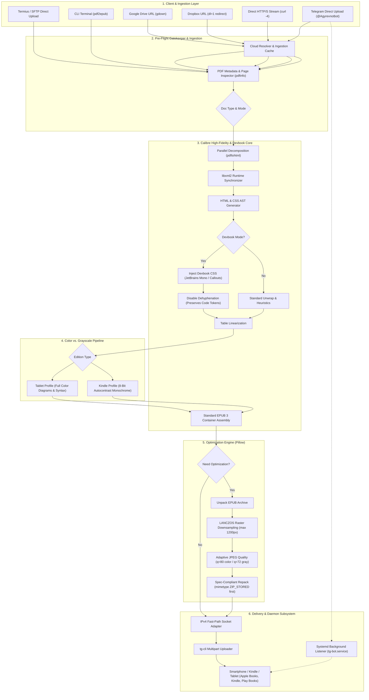

# Universal PDF to EPUB Converter & Telegram Bot Pipeline

[](LICENSE)
[](https://python.org)
[](https://calibre-ebook.com)
[](https://core.telegram.org/bots/api)

A high-performance, headless toolkit that transforms complex PDF documents into clean, reflowable **EPUB 3** eBooks without broken line wraps, fractured paragraphs, or distorted layouts, and instantly delivers them to mobile devices via **Telegram**.

Tested and verified on massive textbooks (up to 1,000+ pages, 1,000+ embedded figures, 160+ MB PDFs).

---

## 🏗️ System Design & Architecture



---

## ⚡ Large PDF Optimization Engine: Under the Hood

Converting large, image-heavy PDFs (e.g., academic textbooks, technical manuals, corporate reports) introduces unique challenges that break standard conversion pipelines:

### 1. The Telegram 504 Gateway Timeout Problem
While Telegram Bot API supports files up to 50 MB for `sendDocument`, Telegram's reverse proxy enforces an internal timeout (~120 seconds). Uploading archives containing 1,000+ uncompressed PNGs often exceeds this timeout, resulting in `504 Gateway Timeout`.

### 2. Automated Two-Stage Optimization
To solve this, `pdf2epub` incorporates an automated image recompression engine:
1. **Calibre Pre-Tuning**: Flags like `--max-image-res=1440x1920`, `--subset-embedded-fonts`, and `--epub-flatten` prevent unnecessary font and canvas bloat during initial conversion.
2. **Lossless/Perceptual Raster Compacting**:
   - Inspects all images in the generated EPUB container.
   - Downsamples raster images exceeding `960px` using high-quality `LANCZOS` resampling.
   - Converts non-alpha PNG graphics (e.g., accounting ledgers, diagrams, graphs) into optimized JPEGs at quality `70`.
   - **EPUB Spec Preservation**: The archive is repacked ensuring the `mimetype` file is placed first and stored uncompressed (`ZIP_STORED`), while remaining assets are deflated (`ZIP_DEFLATED`).

> **Real-World Benchmark:**
> * Input: **167 MB PDF** (*Principles of Accounting, Vol 1*, 973 pages, 1,190 embedded images).
> * Unoptimized EPUB: **140 MB** (times out on Telegram).
> * Optimized Output: **27.5 MB** (compressed in ~12 seconds, uploads to Telegram in ~15 seconds).

---

## 💻 Developer Books (Devbooks) & Code Integrity

Converting software engineering, DevOps, and technical architecture books requires specialized handling that ordinary eBook converters miss:

### 1. Code Block Preservation vs. Destructive Dehyphenation
- **The Issue**: Standard eBook heuristics assume words containing hyphens at line endings are hyphenated prose (`con- \n figuration`). When applied to source code, commands like `-DskipTests`, Maven/Gradle dependencies (`quarkus-resteasy-reactive`), or CSS properties (`font-family`) get erroneously merged or mangled. Even worse, Calibre's vocabulary heuristics enter quadratic token lookups on code tokens, freezing conversions for 7+ minutes.
- **The Fix**: `pdf2epub` detects devbooks, disables destructive hyphenation (`--disable-dehyphenate`), and optimizes unwrap factor (`0.35`) so CLI commands, JSON/YAML configs, and code snippets stay 100% verbatim.

### 2. Devbook Typography & Monospace Styling
All code listings (`<pre>`, `<code>`, `<tt>`, `<kbd>`) are injected with a professional developer styling stack:
* **Font Hierarchy**: `'JetBrains Mono', 'Fira Code', Menlo, Monaco, Consolas, monospace`.
* **Container Styling**: Light modern code background (`#f6f8fa`), border accent (`#007acc`), and `white-space: pre-wrap` to prevent code lines from overflowing mobile screens.
* **Callouts & Aside Boxes**: Distinct left-bordered quote blocks for tips, architectural notes, and cautionary warnings.
* **Deep TOC Navigation**: Unlocked multi-level chapter, section, and sub-heading hierarchy (`--max-toc-links=0 --toc-threshold=4`).

### 3. Dual-Edition Output: Full Color vs. E-Ink Grayscale
Technical readers read across different devices. `pdf2epub` supports simultaneous dual generation:

```bash
# Generate BOTH editions with one command
pdf2epub /tmp/Quarkus_in_Action.pdf --both -t
```

| Feature | 📘 Full Color Edition | 📱 E-Ink Grayscale Edition |
| :--- | :--- | :--- |
| **Target Devices** | iPad, Tablets, Desktop, Web Reader | Kindle Paperwhite, Kobo, Boox Palma |
| **Image Pipeline** | Full-color diagrams, architecture schematics | High-contrast 8-bit monochrome (`autocontrast`) |
| **Output Profile** | `--output-profile=tablet` | `--output-profile=kindle` |
| **File Footprint** | ~3.5 MB – 15 MB | **3.3 MB** (~75% reduction) |
| **Battery Impact** | Normal | Ultra-low E-Ink refresh & battery drain |

---

## 🧠 Why Standard PDF to EPUB Conversion Fails

PDF is a **page-description language** intended for static print rendering with fixed coordinates, while EPUB is a **dynamic reflowable format** meant for varied screen dimensions:

| Failure Mode | Naive Conversion Result | How Our Pipeline Fixes It |
| :--- | :--- | :--- |
| **Hard-Wrapped Lines** | Every printed line becomes a distinct paragraph with unnatural line breaks. | `--enable-heuristics` + `--unwrap-lines` with `--html-unwrap-factor=0.45` semantically joins wrapped sentences using trailing punctuation analysis. |
| **Broken Hyphenation** | Words cut at line endings remain split with trailing hyphens (`in- \n formation`). | Calibre document-level vocabulary analysis reconstructs original compound words and removes layout hyphens. |
| **Table Formatting** | Multi-column tabular data overflows smartphone screens horizontally. | `--linearize-tables` converts 2D layout tables into structured linear reader cards. |
| **Headers & Page Numbers** | Header text and page numbers get interspersed into the middle of reading text. | Calibre regex header/footer detection isolates running headers from primary body copy. |
| **Typography & Formatting** | Straight quotes and hyphens look amateurish on high-res displays. | `--smarten-punctuation` applies typographic quotation marks (`“”`), em/en dashes (`—`), and proper ellipses (`…`). |

---

## 🚀 Quickstart & Installation

### Step 1: Clone and Run the Installer
```bash
git clone https://github.com/intelQong/pdf2epub.git
cd pdf2epub
chmod +x install.sh
./install.sh
```

The script will:
1. Install Calibre (`ebook-convert`), Python 3, and `curl`.
2. Link `pdf2epub`, `tg-cli`, `tg-send`, and `telegram-send` into `/usr/local/bin`.
3. Create your configuration directory at `~/.config/telegram/`.
4. Register the systemd user service `tg-bot.service`.

---

### Step 2: Configure Your Telegram Bot

1. Open Telegram and message [@BotFather](https://t.me/BotFather).
2. Send `/newbot` and follow instructions to get your **Bot Token** (`123456789:ABC...`).
3. Press **Start** (`/start`) in the conversation with your new bot.
4. Set your configuration:
   ```bash
   tg-cli config --set-token "YOUR_BOT_TOKEN" --set-chat-id "YOUR_CHAT_ID"
   ```
5. Test the connection:
   ```bash
   tg-cli status --ping
   ```

---

## 💻 CLI Usage Guide

### 1. Convert Local PDF and Dispatch to Telegram
```bash
# Basic conversion and immediate Telegram delivery
pdf2epub /path/to/document.pdf -t

# Devbook Dual-Edition: Builds BOTH Color and E-Ink Grayscale editions
pdf2epub Quarkus_in_Action.pdf --both -t

# Dedicated E-Ink Grayscale Edition (Kindle / Kobo optimized)
pdf2epub Technical_Manual.pdf --grayscale -t

# Custom title, author, and Telegram caption
pdf2epub document.pdf -t --title "Document Title" --author "Author Name" --caption "📖 Here is your book!"
```

### 2. Convert from Cloud Storage Links
```bash
# Google Drive link
pdf2epub "https://drive.google.com/file/d/1X-example-id/view?usp=sharing" -t

# Dropbox link
pdf2epub "https://www.dropbox.com/s/example/document.pdf?dl=0" -t

# Direct HTTP/HTTPS PDF URL
pdf2epub "https://example.com/downloads/annual_report.pdf" -t
```

### 3. Standalone Telegram CLI Commands
```bash
# Send a text message (HTML supported by default)
tg-send "Conversion finished on server."

# Send any document or file
tg-cli doc /path/to/archive.zip --caption "Backup archive"

# Send via plain text
tg-cli send "Unformatted raw message" --plain
```

---

## 🤖 Running as an Autonomous Telegram Bot

Enable the systemd service to turn your server into a 24/7 personal conversion bot:

```bash
# Start the bot service
systemctl --user start tg-bot.service

# Check live status
systemctl --user status tg-bot.service

# Follow real-time logs
journalctl --user -u tg-bot.service -f
```

Whenever you drop a `.pdf` file or paste a cloud link (Google Drive, Dropbox) into your chat with the bot in Telegram:
1. The bot confirms receipt: `Received <file>.pdf. Converting to EPUB with Calibre...`
2. It processes the document through the high-fidelity conversion & optimization pipeline.
3. It replies with the clean, formatted `.epub` ready to open in Apple Books, Kindle, or Google Play Books.

---

## 📁 Repository Structure

```
pdf2epub/
├── pdf2epub.py               # High-fidelity converter CLI, cloud downloader & Pillow optimizer
├── tg_cli.py                 # Universal Telegram CLI & daemon listener
├── install.sh                # Zero-config automated installer
├── .env.example              # Configuration template
├── systemd/
│   └── tg-pdf-bot.service    # Systemd service unit definition
└── README.md                 # System design & technical documentation
```

---

## 🛡️ License

This project is licensed under the [MIT License](LICENSE).
