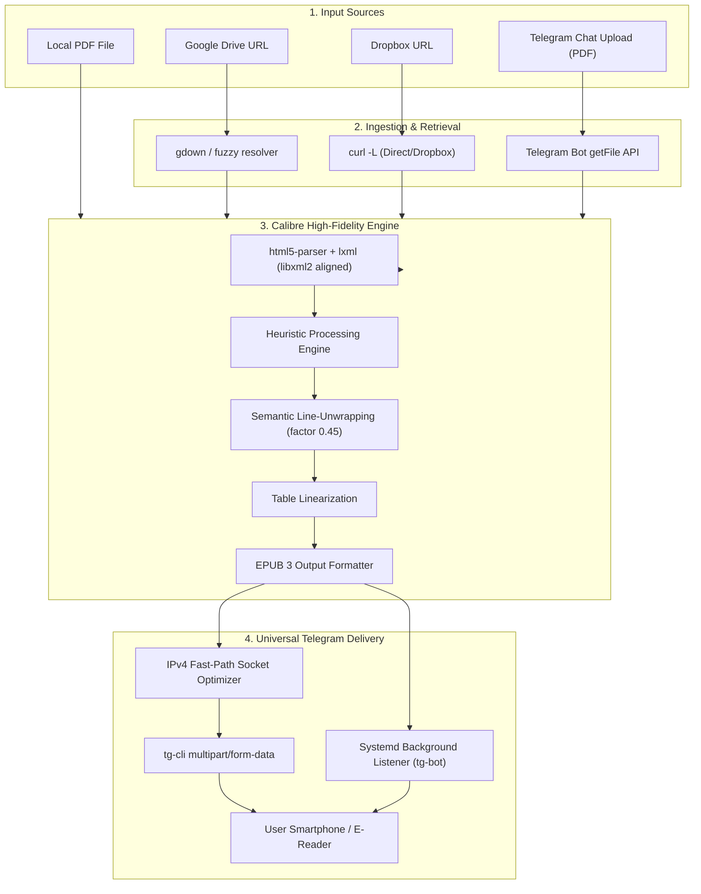

# Universal PDF to EPUB Converter & Telegram Bot Pipeline

[](LICENSE)
[](https://python.org)
[](https://calibre-ebook.com)
[](https://core.telegram.org/bots/api)

A production-grade, headless toolkit that transforms PDF documents into clean, reflowable **EPUB 3** eBooks without broken line wraps, fractured paragraphs, or distorted layouts, and instantly delivers them to mobile devices via **Telegram**.

---

## 📌 Architecture Overview



---

## 🧠 Why Standard PDF to EPUB Conversion Fails (And How We Fix It)

PDF is a **page-description language** intended for static print rendering with fixed coordinates, while EPUB is a **dynamic reflowable format** meant for varied screen dimensions. Naive conversions fail catastrophically in four critical ways:

| Failure Mode | Naive Conversion Result | How Our Pipeline Fixes It |
| :--- | :--- | :--- |
| **Hard-Wrapped Lines** | Every printed line becomes a distinct paragraph with unnatural line breaks. | `--enable-heuristics` + `--unwrap-lines` with `--html-unwrap-factor=0.45` semantically joins wrapped sentences using trailing punctuation analysis. |
| **Broken Hyphenation** | Words cut at line endings remain split with trailing hyphens (`in- \n formation`). | Calibre document-level vocabulary analysis reconstructs original compound words and removes layout hyphens. |
| **Table Formatting** | Multi-column tabular data overflows smartphone screens horizontally. | `--linearize-tables` converts 2D layout tables into structured linear reader cards. |
| **Headers & Page Numbers** | Header text and page numbers get interspersed into the middle of reading text. | Calibre regex header/footer detection isolates running headers from primary body copy. |
| **Typography & Formatting** | Straight quotes and hyphens look amateurish on high-res displays. | `--smarten-punctuation` applies typographic quotation marks (`“”`), em/en dashes (`—`), and proper ellipses (`…`). |

---

## ⚙️ Technical Highlights

### 1. Zero External Runtime Dependencies for Telegram
The Telegram CLI (`tg_cli.py`) utilizes standard library `urllib` and `curl`, requiring **no third-party pip packages**. This ensures 100% portability across fresh server installs, minimal containers, and hardened cloud environments.

### 2. IPv4 Socket Fast-Path
In many cloud and VPS environments, IPv6 DNS resolution is returned but egress traffic is blocked or unrouted, creating 30+ second connection timeouts. `tg_cli.py` patches `socket.getaddrinfo` dynamically to prefer `socket.AF_INET`, achieving sub-second API round-trips.

### 3. Libxml2 Version Synchronization
When Calibre is installed on Debian/Ubuntu systems, pip-installed wheels of `lxml` can conflict with system `html5-parser` compiled against system `libxml2`. The automated installer verifies and synchronizes runtime dependencies to prevent conversion runtime aborts.

### 4. Dual-Mode Architecture
- **CLI Mode**: Direct commands for terminal, cron, scripts, or orchestrators (`pdf2epub`, `tg-send`).
- **Interactive Daemon Mode**: A lightweight systemd user service (`tg-bot.service`) that listens for user PDF uploads in Telegram and converts them automatically on-demand.

---

## 🚀 Quickstart & Installation

### Step 1: Clone and Run the Installer
```bash
git clone https://github.com/intelQong/pdf2epub.git
cd pdf2epub
chmod +x install.sh
./install.sh
```

The script will:
1. Install Calibre (`ebook-convert`), Python 3, and `curl`.
2. Link `pdf2epub`, `tg-cli`, `tg-send`, and `telegram-send` into `/usr/local/bin`.
3. Create your configuration directory at `~/.config/telegram/`.
4. Register the systemd user service `tg-bot.service`.

---

### Step 2: Configure Your Telegram Bot

1. Open Telegram and message [@BotFather](https://t.me/BotFather).
2. Send `/newbot` and follow instructions to get your **Bot Token** (`123456789:ABC...`).
3. Press **Start** (`/start`) in the conversation with your new bot.
4. Set your configuration:
   ```bash
   tg-cli config --set-token "YOUR_BOT_TOKEN" --set-chat-id "YOUR_CHAT_ID"
   ```
5. Test the connection:
   ```bash
   tg-cli status --ping
   ```

---

## 💻 CLI Usage Guide

### 1. Convert Local PDF and Dispatch to Telegram
```bash
# Basic conversion and immediate Telegram delivery
pdf2epub /path/to/document.pdf -t

# Custom title, author, and Telegram caption
pdf2epub document.pdf -t --title "Document Title" --author "Author Name" --caption "📖 Here is your converted book!"
```

### 2. Convert from Cloud Storage Links
```bash
# Google Drive link
pdf2epub "https://drive.google.com/file/d/1X-example-id/view?usp=sharing" -t

# Dropbox link
pdf2epub "https://www.dropbox.com/s/example/document.pdf?dl=0" -t

# Direct HTTP/HTTPS PDF URL
pdf2epub "https://example.com/downloads/annual_report.pdf" -t
```

### 3. Standalone Telegram CLI Commands
```bash
# Send a text message (HTML supported by default)
tg-send "Conversion finished on server."

# Send any document or file
tg-cli doc /path/to/archive.zip --caption "Backup archive"

# Send via plain text
tg-cli send "Unformatted raw message" --plain
```

---

## 🤖 Running as an Autonomous Telegram Bot

Enable the systemd service to turn your server into a 24/7 personal conversion bot:

```bash
# Start the bot service
systemctl --user start tg-bot.service

# Check live status
systemctl --user status tg-bot.service

# Follow real-time logs
journalctl --user -u tg-bot.service -f
```

Whenever you drop a `.pdf` file into your chat with the bot in Telegram:
1. The bot confirms receipt: `Received <file>.pdf. Converting to EPUB with Calibre...`
2. It processes the document through the high-fidelity conversion pipeline.
3. It replies with the clean, formatted `.epub` ready to open in Apple Books, Kindle, or Google Play Books.

---

## 📁 Repository Structure

```
pdf2epub/
├── pdf2epub.py               # High-fidelity converter CLI & cloud downloader
├── tg_cli.py                 # Universal Telegram CLI & daemon listener
├── install.sh                # Zero-config automated installer
├── .env.example              # Configuration template
├── systemd/
│   └── tg-pdf-bot.service    # Systemd service unit definition
└── README.md                 # Technical documentation
```

---

## 🛡️ License

This project is licensed under the [MIT License](LICENSE).
